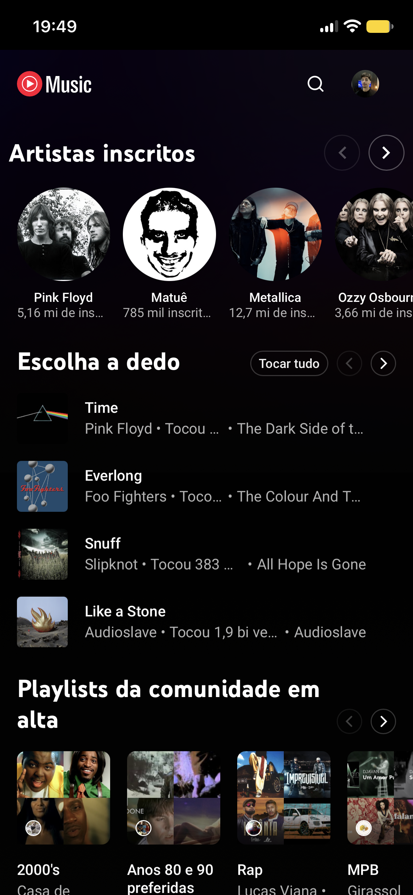
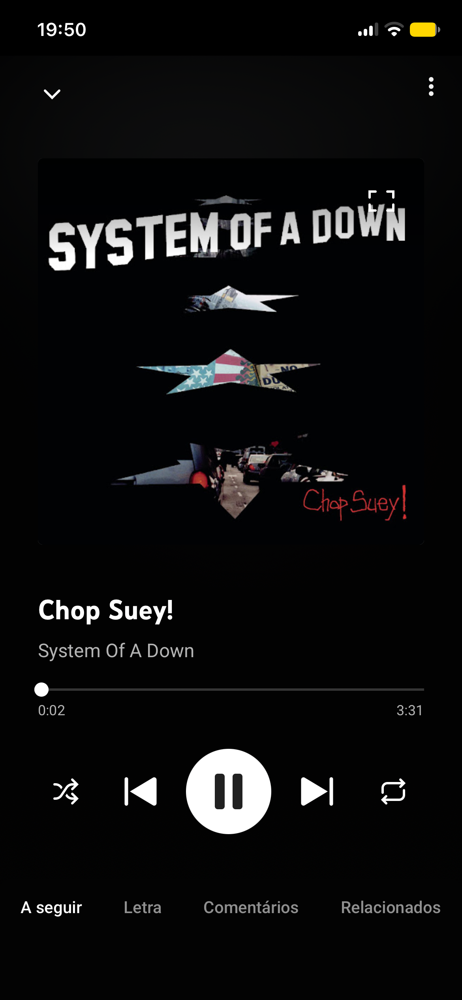

<div align="center">

# YTMusicGo

**YouTube Music on your iPhone, without ads.**


[](LICENSE)

[Features](#features) • [Install](#install) • [Usage](#usage) • [How it works](#how-it-works) • [Customize](#customize) • [Limitations](#limitations)

English • <a href="README.pt-BR.md">Português</a>

</div>

YTMusicGo is a native iOS app that plays [YouTube Music](https://music.youtube.com) full screen. It blocks ads, hides the clutter and keeps the music playing when the screen is locked.

The app loads the official YouTube Music website in a `WKWebView`. Your login is kept between launches.

<p align="center">
  
  
</p>

> [!NOTE]
> YTMusicGo is an independent project. It is not affiliated with YouTube or Google.

## Features

- **No ads:** network rules block ad requests and an injected script skips and hides what gets through.
- **Subscribed artists carousel:** the home page starts with the artists you follow.
- **Cleaner interface:** no hamburger menu and no **Baixar** item in the track menus.
- **Quick start:** artist pages and search results get an **Iniciar** button before Aleatório and Mix.
- **Original track order:** shuffle is turned off when a playlist or album starts, and playback stops at the end instead of drifting to suggestions.
- **Background audio:** music keeps playing when you lock the screen or switch apps.

## Install

There is no App Store build. Install from source on your own iPhone.

Requirements:

- macOS with Xcode 15 or later
- [XcodeGen](https://github.com/yonaskolb/XcodeGen)
- An iPhone with iOS 17 or later and **Developer Mode** turned on (Settings, Privacy & Security)
- An Apple ID signed in at Xcode, Settings, Accounts

```bash
brew install xcodegen
git clone https://github.com/CarlosAllberto/ytmusicgo.git
cd ytmusicgo
xcodegen generate
open YTMusicGo.xcodeproj
```

In Xcode, select your iPhone as the destination and press <kbd>⌘</kbd> <kbd>R</kbd>. If signing fails, change `DEVELOPMENT_TEAM` in [`project.yml`](project.yml) to your own team ID and run `xcodegen generate` again.

On the iPhone, open Settings, General, VPN & Device Management, and trust your developer profile. Then open the app.

> [!NOTE]
> With a free Apple ID, the app expires after 7 days and you need to install it again.

To try it in the iOS Simulator, pick any simulator as the destination. Use iOS 17 or later.

## Usage

Open the app and sign in with your Google account on the first launch. After that, use YouTube Music as usual.

## How it works

```
YTMusicGo/
├── App.swift       App entry point, audio session and WebView
├── AdBlock.swift   Compiles the network block rules
└── Resources/      Injected scripts and network rules
```

- **Desktop site.** The injected scripts depend on the `ytmusic-app` DOM, which the mobile site does not have. The `WKWebView` uses a desktop user agent and desktop content mode.
- **Audio session.** The app sets the `.playback` category and enables the `audio` background mode. Without them, iOS mutes the page when the screen locks.
- **Block rules first.** The page loads only after every `Resources/rules*.json` file compiles, or ad requests would slip through.
- **Three injected scripts** in [`YTMusicGo/Resources`](YTMusicGo/Resources):
  - `inject-ads.js` skips ads and removes promotions.
  - `inject-order.js` keeps the original track order.
  - `inject-ui.js` hides elements and adds the carousel and the buttons.

## Customize

YouTube changes its page often. Each script keeps its selectors in a `CONFIG` object at the top of the file:

| What | Where |
| --- | --- |
| Ad selectors | `CONFIG` in `inject-ads.js` |
| Track order selectors | `CONFIG` in `inject-order.js` |
| Hidden elements, carousel, buttons | `CONFIG` in `inject-ui.js` |

**Network rules.** Every `Resources/rules*.json` file is compiled at launch. To add a list, put a `rules-name.json` file in `YTMusicGo/Resources` in the WebKit content rule list format, then run `xcodegen generate`.

## Limitations

> [!NOTE]
> Ad blocking and the interface changes depend on YouTube's HTML and can break at any time. If something stops working, update the selectors above.

- Portrait orientation only, on iPhone.
- One account at a time.
- The app menus and some buttons are in Portuguese. YouTube Music follows your account language.

## Development

Debug builds turn on the Web Inspector. Connect the iPhone, then inspect the `WKWebView` from Safari's Develop menu.
