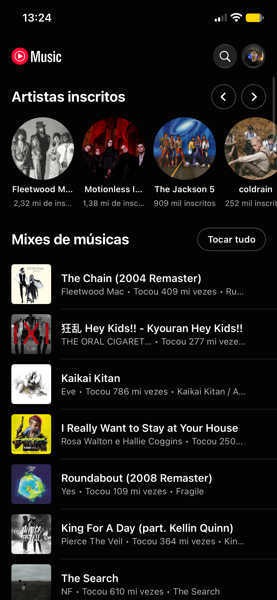
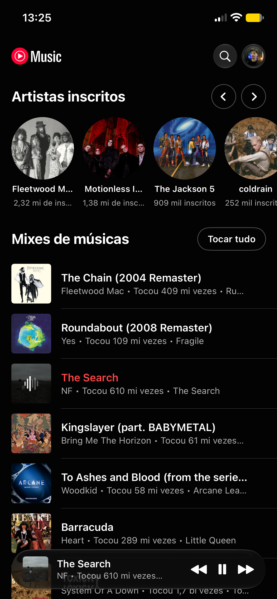
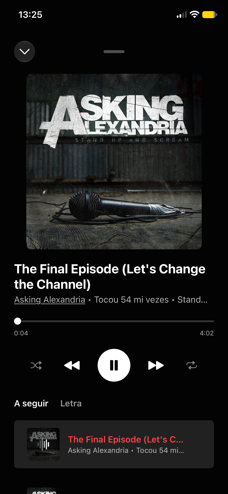
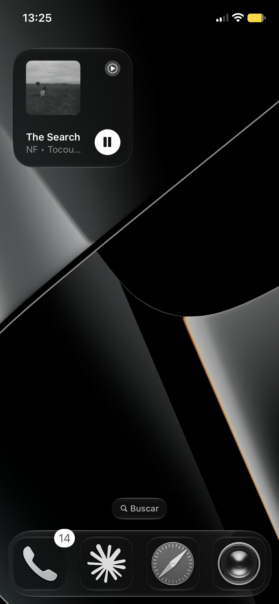

<div align="center">


# YTMusicGo

**YouTube Music on your iPhone, without ads.**


[](LICENSE)

[Features](#features) • [Install](#install) • [Usage](#usage) • [How it works](#how-it-works) • [Customize](#customize) • [Limitations](#limitations) • [Development](#development)

English • <a href="README.pt-BR.md">Português</a>

</div>

YTMusicGo is an iOS app with a native SwiftUI interface for [YouTube Music](https://music.youtube.com). Home, search, artists, albums, playlists, your library and lyrics are drawn natively from YouTube Music's internal API.

Audio plays through the official player in a hidden `WKWebView`, with ads blocked, and keeps playing when the screen is locked. Your login is kept between launches.

<p align="center">
  
  
  
  
</p>

> [!NOTE]
> YTMusicGo is an independent project. It is not affiliated with YouTube or Google.

## Features

- **Native interface:** home, artist, album and playlist pages, and your library (saved playlists and albums, liked songs, subscribed artists) in SwiftUI, not a web page. Uses Liquid Glass on iOS 26.
- **Search as you type:** top result plus artists, songs and albums.
- **Subscribed artists first:** when you are signed in, home and library start with the artists you follow.
- **Lyrics with translation:** the player screen shows the lyrics when YouTube Music has them, and **Traduzir** translates them to Portuguese.
- **Queue:** "A seguir" list, shuffle, repeat all or one, and seeking on the progress bar. Artist pages get **Iniciar** and **Aleatório** buttons, and track lists get **Tocar tudo**.
- **Original track order:** playback stops at the end of the queue instead of drifting to YouTube's automatic radio.
- **Home screen widget:** a small widget with the cover, title, artist and a play/pause button.
- **No ads:** network rules block ad requests and an injected script skips what gets through.
- **Background audio:** music keeps playing when you lock the screen or switch apps, with the lock screen and Control Center controls.

## Install

There is no App Store build. Install from source on your own iPhone.

Requirements:

- macOS with Xcode 26 or later
- [XcodeGen](https://github.com/yonaskolb/XcodeGen)
- An iPhone with iOS 17 or later and **Developer Mode** turned on (Settings, Privacy & Security)
- An Apple ID signed in at Xcode, Settings, Accounts

```bash
brew install xcodegen
git clone https://github.com/CarlosAllberto/ytmusicgo.git
cd ytmusicgo
xcodegen generate
open YTMusicGo.xcodeproj
```

In Xcode, select your iPhone as the destination and press <kbd>⌘</kbd> <kbd>R</kbd>. If signing fails, change `DEVELOPMENT_TEAM` in [`project.yml`](project.yml) to your own team ID and run `xcodegen generate` again.

On the iPhone, open Settings, General, VPN & Device Management, and trust your developer profile. Then open the app.

> [!NOTE]
> With a free Apple ID, the app expires after 7 days and you need to install it again.

To try it in the iOS Simulator, pick any simulator as the destination. Use iOS 17 or later.

## Usage

| Action | How |
| --- | --- |
| Sign in | Tap the person icon at the top right |
| Search | Tap the magnifying glass and type |
| Play a track | Tap it. The rest of the list becomes the queue |
| Open the player | Tap the mini player at the bottom |
| Close the player | Drag it down, or tap the arrow at the top |
| Open the library or sign out | Tap your profile photo |
| Open an artist | Tap the artist name under a track |

Without signing in, search, artists, albums and playlists work. Home shows a notice asking you to sign in, and the library needs an account.

## How it works

```
YTMusicGo/
├── App/App.swift            App entry point, home, pages, mini player
├── Views/PlayerView.swift   Full screen player, queue, lyrics
├── Services/
│   ├── InnerTube.swift      YouTube Music internal API client and parser
│   ├── Player.swift         Hidden WKWebView, queue, playback control
│   ├── Auth.swift           Google sign in and authenticated headers
│   ├── Translate.swift      Lyrics translation
│   ├── Prefs.swift          Settings
│   └── Support.swift        High resolution thumbnails
├── Shared/NowPlaying.swift  Current track shared with the widget
├── WebView/AdBlock.swift    Compiles the network block rules
└── Resources/               inject-ads.js, rules.json, icon and logo
YTMusicGoWidget/             Home screen widget
```

- **Data:** [`InnerTube.swift`](YTMusicGo/Services/InnerTube.swift) calls `music.youtube.com/youtubei/v1` (`browse`, `search`, `next`) as the `WEB_REMIX` client. The parser walks the JSON looking for shelves and items instead of fixed paths, because YouTube changes the shape often.
- **Search:** without a filter the API only returns the top card, so the app runs three filtered searches (artists, songs, albums) in parallel, plus one for the best result.
- **Sign in:** a Google sign in page in a `WKWebView`. The app is signed in when the `SAPISID` cookie exists, and sends it with a `SAPISIDHASH` header. The player shares the same cookies, so it plays with your account and Premium.
- **Player:** [`Player.swift`](YTMusicGo/Services/Player.swift) loads `music.youtube.com/watch` in a `WKWebView` that never shows and is never destroyed. The official player handles signatures and streaming. The app controls the `<video>` element through JavaScript and keeps its own queue.
- **Lock screen:** WebKit publishes the track to the system from the site's `navigator.mediaSession`. A script sends next and previous back to the app's queue.
- **Widget:** the app writes the current track and cover to an App Group and reloads the widget. The play button is an `AudioPlaybackIntent`, which iOS runs inside the app.
- **Ads:** the page loads only after every `Resources/rules*.json` file compiles, and `inject-ads.js` skips and mutes ads that get through.

## Customize

| What | Where |
| --- | --- |
| API client version | `clientVersion` in `InnerTube.post` |
| Search filters | `params` in `InnerTube.search` |
| Ad selectors | `CONFIG` in [`inject-ads.js`](YTMusicGo/Resources/inject-ads.js) |
| Colors | `Theme` in [`App.swift`](YTMusicGo/App/App.swift) |

**Network rules.** Every `Resources/rules*.json` file is compiled at launch. To add a list, put a `rules-name.json` file in `YTMusicGo/Resources` in the WebKit content rule list format, then run `xcodegen generate`.

## Limitations

> [!NOTE]
> The internal API is not public. If YouTube rejects the client version or changes the JSON, pages come back empty until the code is updated.

- Portrait orientation only, on iPhone.
- One account at a time.
- The interface is in Portuguese.
- Translation uses Google's free unofficial endpoint, which can stop working without notice.
- The logo and icon are YouTube Music's trademarks, for personal use only.

## Development

[`scripts/harness`](scripts/harness) builds the data layer as a command line tool and checks every endpoint against the real API, without signing in:

```bash
scripts/harness/run.sh
```

Run it after changing the parser or when pages come back empty.
