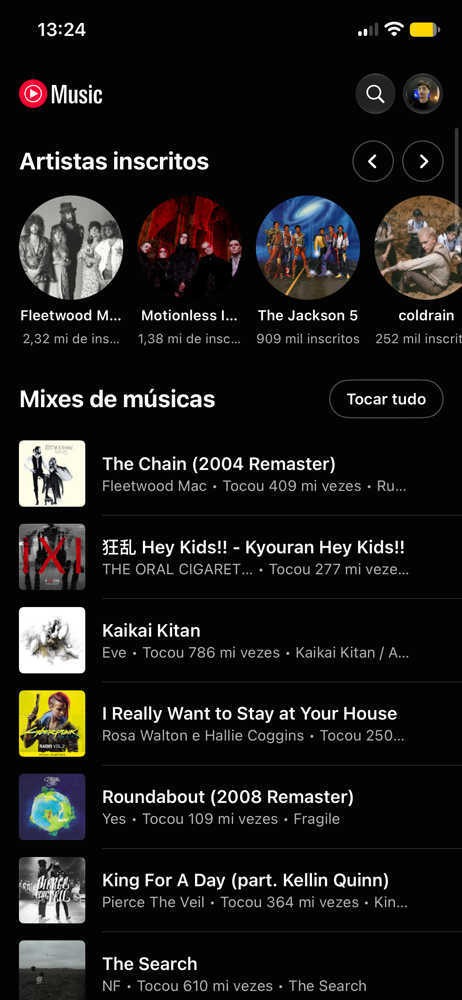
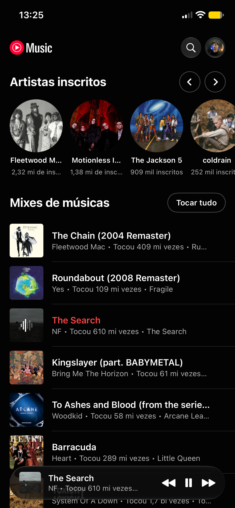
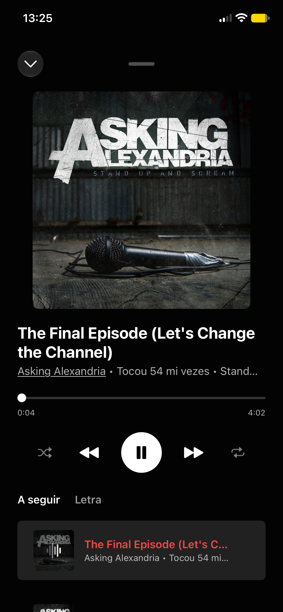
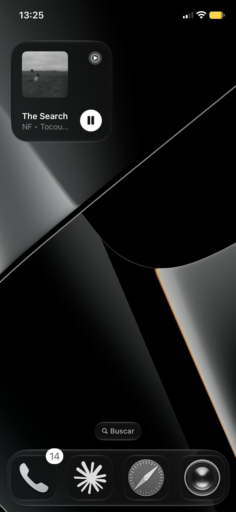

<div align="center">


# YTMusicGo

**YouTube Music no seu iPhone, sem anúncios.**


[](LICENSE)

[Recursos](#recursos) • [Instalação](#instalação) • [Uso](#uso) • [Como funciona](#como-funciona) • [Personalização](#personalização) • [Limitações](#limitações) • [Desenvolvimento](#desenvolvimento)

<a href="README.md">English</a> • Português

</div>

YTMusicGo é um app para iOS com interface nativa em SwiftUI para o [YouTube Music](https://music.youtube.com). Início, busca, artistas, álbuns, playlists, sua biblioteca e letras são desenhados nativamente a partir da API interna do YouTube Music.

O áudio toca pelo player oficial numa `WKWebView` escondida, com os anúncios bloqueados, e continua tocando com a tela bloqueada. Seu login é mantido entre as aberturas.

<p align="center">
  
  
  
  
</p>

> [!NOTE]
> YTMusicGo é um projeto independente. Não tem relação com o YouTube nem com o Google.

## Recursos

- **Interface nativa:** páginas de início, artista, álbum e playlist, e sua biblioteca (playlists e álbuns salvos, músicas curtidas, artistas inscritos) em SwiftUI, não numa página web. Usa Liquid Glass no iOS 26.
- **Busca ao digitar:** melhor resultado, artistas, músicas e álbuns.
- **Artistas inscritos primeiro:** com login, o início e a biblioteca começam pelos artistas que você segue.
- **Letra com tradução:** a tela do player mostra a letra quando o YouTube Music tem, e **Traduzir** passa para o português.
- **Fila:** lista "A seguir", aleatório, repetir todas ou uma, e busca na barra de progresso. Páginas de artista ganham **Iniciar** e **Aleatório**, e listas de faixas ganham **Tocar tudo**.
- **Ordem original das faixas:** a reprodução para no fim da fila em vez de seguir para a rádio automática do YouTube.
- **Widget na tela inicial:** um widget pequeno com capa, título, artista e botão de tocar e pausar.
- **Sem anúncios:** regras de rede bloqueiam as requisições de anúncio e um script injetado pula o que passar.
- **Áudio em segundo plano:** a música continua tocando com a tela bloqueada ou em outro app, com os controles da tela bloqueada e da Central de Controle.

## Instalação

Não há versão na App Store. Instale a partir do código no seu próprio iPhone.

Requisitos:

- macOS com Xcode 26 ou mais recente
- [XcodeGen](https://github.com/yonaskolb/XcodeGen)
- Um iPhone com iOS 17 ou mais recente e o **Modo de Desenvolvedor** ligado (Ajustes, Privacidade e Segurança)
- Um Apple ID conectado em Xcode, Settings, Accounts

```bash
brew install xcodegen
git clone https://github.com/CarlosAllberto/ytmusicgo.git
cd ytmusicgo
xcodegen generate
open YTMusicGo.xcodeproj
```

No Xcode, escolha o seu iPhone como destino e aperte <kbd>⌘</kbd> <kbd>R</kbd>. Se a assinatura falhar, troque `DEVELOPMENT_TEAM` no [`project.yml`](project.yml) pelo ID do seu time e rode `xcodegen generate` de novo.

No iPhone, abra Ajustes, Geral, VPN e Gerenciamento de Dispositivos, e confie no seu perfil de desenvolvedor. Depois abra o app.

> [!NOTE]
> Com um Apple ID gratuito, o app expira depois de 7 dias e precisa ser instalado de novo.

Para testar no Simulador do iOS, escolha qualquer simulador como destino. Use iOS 17 ou mais recente.

## Uso

| Ação | Como |
| --- | --- |
| Entrar na conta | Toque no ícone de pessoa no canto superior direito |
| Buscar | Toque na lupa e digite |
| Tocar uma faixa | Toque nela. O resto da lista vira a fila |
| Abrir o player | Toque no mini player embaixo |
| Fechar o player | Arraste para baixo, ou toque na seta do topo |
| Abrir a biblioteca ou sair da conta | Toque na sua foto de perfil |
| Abrir um artista | Toque no nome do artista embaixo da faixa |

Sem login, busca, artistas, álbuns e playlists funcionam. O início mostra um aviso pedindo para entrar, e a biblioteca precisa de conta.

## Como funciona

```
YTMusicGo/
├── App/App.swift            Entrada do app, início, páginas, mini player
├── Views/PlayerView.swift   Player em tela cheia, fila, letra
├── Services/
│   ├── InnerTube.swift      Cliente e parser da API interna do YouTube Music
│   ├── Player.swift         WKWebView escondida, fila, controle da reprodução
│   ├── Auth.swift           Login Google e cabeçalhos autenticados
│   ├── Translate.swift      Tradução da letra
│   ├── Prefs.swift          Configurações
│   └── Support.swift        Miniaturas em alta resolução
├── Shared/NowPlaying.swift  Faixa atual compartilhada com o widget
├── WebView/AdBlock.swift    Compila as regras de bloqueio de rede
└── Resources/               inject-ads.js, rules.json, ícone e logo
YTMusicGoWidget/             Widget da tela inicial
```

- **Dados:** o [`InnerTube.swift`](YTMusicGo/Services/InnerTube.swift) chama `music.youtube.com/youtubei/v1` (`browse`, `search`, `next`) como o cliente `WEB_REMIX`. O parser percorre o JSON procurando prateleiras e itens em vez de caminhos fixos, porque o YouTube muda o formato com frequência.
- **Busca:** sem filtro a API só devolve o card do topo, então o app faz três buscas filtradas (artistas, músicas, álbuns) em paralelo, mais uma para o melhor resultado.
- **Login:** uma página de login do Google numa `WKWebView`. O app está logado quando existe o cookie `SAPISID`, e o envia com um cabeçalho `SAPISIDHASH`. O player usa os mesmos cookies, então toca com a sua conta e o Premium.
- **Player:** o [`Player.swift`](YTMusicGo/Services/Player.swift) carrega `music.youtube.com/watch` numa `WKWebView` que nunca aparece e nunca é destruída. O player oficial cuida das assinaturas e do streaming. O app controla o elemento `<video>` por JavaScript e mantém a própria fila.
- **Tela bloqueada:** o WebKit publica a faixa no sistema a partir do `navigator.mediaSession` do site. Um script devolve próxima e anterior para a fila do app.
- **Widget:** o app grava a faixa atual e a capa num App Group e recarrega o widget. O botão de play é um `AudioPlaybackIntent`, que o iOS executa dentro do app.
- **Anúncios:** a página só carrega depois que todos os arquivos `Resources/rules*.json` compilam, e o `inject-ads.js` pula e silencia os anúncios que passarem.

## Personalização

| O quê | Onde |
| --- | --- |
| Versão do cliente da API | `clientVersion` em `InnerTube.post` |
| Filtros da busca | `params` em `InnerTube.search` |
| Seletores de anúncio | `CONFIG` no [`inject-ads.js`](YTMusicGo/Resources/inject-ads.js) |
| Cores | `Theme` no [`App.swift`](YTMusicGo/App/App.swift) |

**Regras de rede.** Todo arquivo `Resources/rules*.json` é compilado na abertura. Para adicionar uma lista, coloque um arquivo `rules-nome.json` em `YTMusicGo/Resources` no formato de content rule list do WebKit e rode `xcodegen generate`.

## Limitações

> [!NOTE]
> A API interna não é pública. Se o YouTube recusar a versão do cliente ou mudar o JSON, as páginas voltam vazias até o código ser atualizado.

- Só na vertical, no iPhone.
- Uma conta por vez.
- A interface é em português.
- A tradução usa o endpoint gratuito e não oficial do Google, que pode parar de funcionar sem aviso.
- O logo e o ícone são marcas do YouTube Music, para uso pessoal.

## Desenvolvimento

O [`scripts/harness`](scripts/harness) compila a camada de dados como ferramenta de linha de comando e confere cada endpoint contra a API real, sem login:

```bash
scripts/harness/run.sh
```

Rode depois de mexer no parser ou quando as páginas voltarem vazias.
