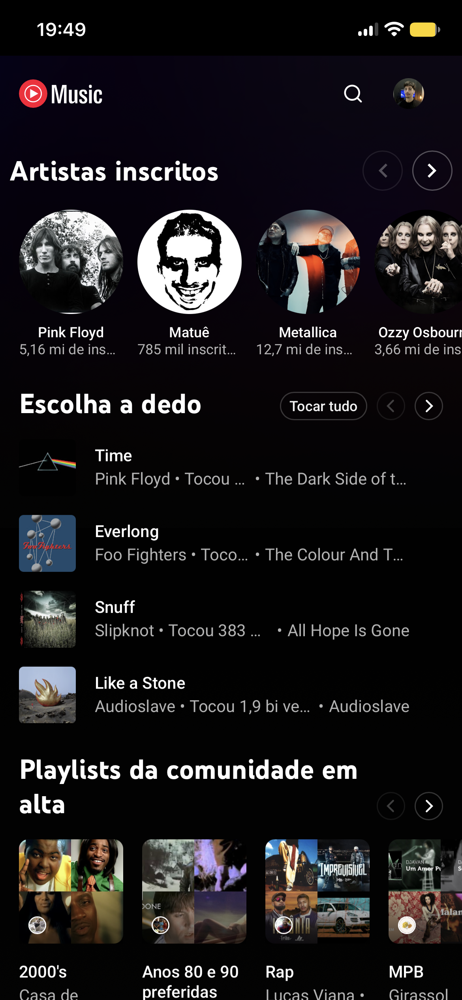
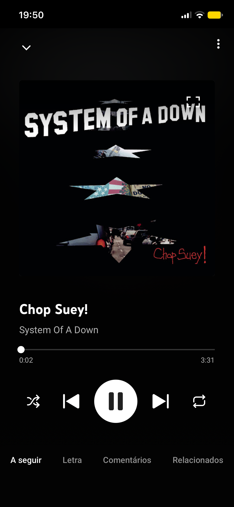

<div align="center">

# YTMusicGo

**YouTube Music no seu iPhone, sem anúncios.**


[Recursos](#recursos) • [Instalação](#instalação) • [Uso](#uso) • [Como funciona](#como-funciona) • [Personalização](#personalização) • [Limitações](#limitações)

<a href="README.md">English</a> • Português

</div>

YTMusicGo é um app nativo para iOS que toca o [YouTube Music](https://music.youtube.com) em tela cheia. Ele bloqueia anúncios, esconde o excesso de elementos e mantém a música tocando com a tela bloqueada.

O app carrega o site oficial do YouTube Music em um `WKWebView`. Seu login é mantido entre as aberturas.

<p align="center">
  
  
</p>

> [!NOTE]
> YTMusicGo é um projeto independente. Não tem relação com o YouTube nem com o Google.

## Recursos

- **Sem anúncios:** regras de rede bloqueiam as requisições de anúncio e um script injetado pula e esconde o que passar.
- **Carrossel de artistas inscritos:** a página inicial começa com os artistas que você segue.
- **Interface mais limpa:** sem menu hambúrguer e sem o item **Baixar** nos menus das faixas.
- **Início rápido:** páginas de artista e resultados de busca ganham um botão **Iniciar** antes de Aleatório e Mix.
- **Ordem original das faixas:** o aleatório é desligado ao iniciar uma playlist ou álbum, e a reprodução para no fim em vez de seguir para sugestões.
- **Áudio em segundo plano:** a música continua tocando com a tela bloqueada ou em outro app.

## Instalação

Não há versão na App Store. Instale a partir do código-fonte no seu iPhone.

Requisitos:

- macOS com Xcode 15 ou superior
- [XcodeGen](https://github.com/yonaskolb/XcodeGen)
- Um iPhone com iOS 17 ou superior e o **Modo Desenvolvedor** ligado (Ajustes, Privacidade e Segurança)
- Um Apple ID logado em Xcode, Settings, Accounts

```bash
brew install xcodegen
git clone https://github.com/CarlosAllberto/ytmusicgo.git
cd ytmusicgo
xcodegen generate
open YTMusicGo.xcodeproj
```

No Xcode, escolha seu iPhone como destino e pressione <kbd>⌘</kbd> <kbd>R</kbd>. Se a assinatura falhar, troque `DEVELOPMENT_TEAM` no [`project.yml`](project.yml) pelo ID do seu time e rode `xcodegen generate` de novo.

No iPhone, abra Ajustes, Geral, VPN e Gerenciamento de Dispositivo, e confie no seu perfil de desenvolvedor. Depois abra o app.

> [!NOTE]
> Com um Apple ID gratuito, o app expira em 7 dias e é preciso instalar de novo.

Para testar no Simulador do iOS, escolha qualquer simulador como destino. Use iOS 17 ou superior.

## Uso

Abra o app e entre com sua conta Google na primeira vez. Depois, use o YouTube Music normalmente.

## Como funciona

```
YTMusicGo/
├── App.swift       Entrada do app, sessão de áudio e WebView
├── AdBlock.swift   Compila as regras de bloqueio de rede
└── Resources/      Scripts injetados e regras de rede
```

- **Site desktop.** Os scripts injetados dependem do DOM do `ytmusic-app`, que o site mobile não tem. O `WKWebView` usa user agent e modo de conteúdo desktop.
- **Sessão de áudio.** O app define a categoria `.playback` e ativa o modo de fundo `audio`. Sem isso, o iOS silencia a página ao bloquear a tela.
- **Regras de bloqueio primeiro.** A página só carrega depois que todos os arquivos `Resources/rules*.json` compilam, senão requisições de anúncio passam.
- **Três scripts injetados** em [`YTMusicGo/Resources`](YTMusicGo/Resources):
  - `inject-ads.js` pula anúncios e remove promoções.
  - `inject-order.js` mantém a ordem original das faixas.
  - `inject-ui.js` esconde elementos e adiciona o carrossel e os botões.

## Personalização

O YouTube muda a página com frequência. Cada script guarda seus seletores em um objeto `CONFIG` no topo do arquivo:

| O quê | Onde |
| --- | --- |
| Seletores de anúncio | `CONFIG` em `inject-ads.js` |
| Seletores da ordem das faixas | `CONFIG` em `inject-order.js` |
| Elementos escondidos, carrossel, botões | `CONFIG` em `inject-ui.js` |

**Regras de rede.** Todo arquivo `Resources/rules*.json` é compilado ao abrir o app. Para adicionar uma lista, coloque um arquivo `rules-nome.json` em `YTMusicGo/Resources` no formato de content rule list do WebKit e rode `xcodegen generate`.

## Limitações

> [!NOTE]
> O bloqueio de anúncios e as mudanças na interface dependem do HTML do YouTube e podem quebrar a qualquer momento. Se algo parar de funcionar, atualize os seletores acima.

- Somente orientação retrato, no iPhone.
- Uma conta por vez.
- Os menus do app e alguns botões estão em português. O YouTube Music segue o idioma da sua conta.

## Desenvolvimento

Builds de debug ligam o Web Inspector. Conecte o iPhone e inspecione o `WKWebView` pelo menu Desenvolver do Safari.
